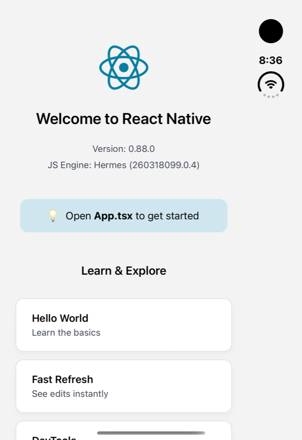

# Phase 1 results: shaking `react-native`'s getters

October 2026. Same apps, versions and method as [Phase 0](phase0-results.md): production bundles, compiled with `hermesc -O`, measured with `shake-report`. Raw data: [`benchmarks/reports/phase1/`](../benchmarks/reports/phase1).

## What shipped

`withTreeShaking(config)` now removes modules that are reachable only through getters on `react-native`'s entry object that nothing reads. How it works: [architecture.md](architecture.md#react-native-getter-shaking-phase-1-shipped). Usage and limits: [packages/react-native-tree-shaker](../packages/react-native-tree-shaker).

## Results

Hermes bytecode, iOS. Android is within 0.4 percentage points.

| App | Baseline | Getter shaking | Getters read | Modules removed | Expo's shaker, for comparison |
|---|---:|---:|---:|---:|---:|
| `rn-template` (React Native CLI) | 1227.3 KiB | 1091.3 KiB, **−11.1%** | 16 of 96 | 100 | not available |
| `bare-expo-preset` (template on Expo's toolchain) | 1266.5 KiB | 1142.2 KiB, **−9.8%** | 16 of 96 | 101 | −2.8% |
| `expo-barrels` (Expo blank template plus barrel-heavy libraries) | 4537.8 KiB | 4168.9 KiB, **−8.1%** | 21 of 96 | 195 | −61.4% |
| `expo-default` (Expo default template) | 3539.1 KiB | 3434.6 KiB, **−3.0%** | 38 of 96 | 81 | −12.2% |

On the template, the raw JS bundle drops 108.5 KiB (−12.5%). The shipped analysis removes exactly the 100 module paths the Phase 0 estimate listed. Phase 0's source scan had also counted `Platform` as read; in Metro's output those reads are already inlined as constants, so the shipped analysis is the more precise of the two.

Getter shaking adds no measurable build time (template, iOS, one run: 3.1 s without, 2.8 s with).

## Findings

1. **It works on stock React Native without replacing Metro's serializer or bundler.** About 11% of Hermes bytecode on the template. No other shaker we know of removes `react-native`'s unread getters. The other options for stock React Native, rnx-kit's esbuild serializer and Re.Pack, replace the serializer or the bundler and weren't measured here.
2. **On a bare app it beats adopting Expo's shaker:** −9.8% against −2.8% on the same app and toolchain.
3. **The more of `react-native` an app uses, the less there is to remove.** Expo's default template reads 38 getters (expo-router, react-native-screens and reanimated use much of the API, including `ScrollView`, which pulls in `Animated` and the lists). There, Expo's general shaker saves far more.
4. **It doesn't stack with Expo's shaker yet.** With `EXPO_UNSTABLE_TREE_SHAKING` on, modules aren't transformed when serialization starts, so the getter analysis skips itself and the bundle is byte-identical to Expo's shaker alone.
5. **Expo's compiled packages needed one extra pattern.** They import `react-native` through Babel's lazy-import helper (`function n(){var t=r(d[0]);return n=function(){return t},t}`). Without support for it, every Expo app was skipped.

## Verification

- **Unit tests** for the getter and read analysis, run on synthetic minified Metro output: scopes, renamed wrapper parameters, destructuring, inline requires, lazy-import helpers, and 11 patterns that must keep everything.
- **End-to-end tests** with real Metro 0.87: the Phase 1 fixtures are bundled with `withTreeShaking`, checked against `expected.json`, and the bundles are executed in Node. A `react-native` namespace import keeps everything. The source map built for a shaken graph matches Metro's own byte for byte when nothing is removed.
- **A release build on iOS.** The template was built in the Release configuration with `withTreeShaking` (Xcode's bundling step logged "16 of 96 read; removed 100 modules") and run in the iOS Simulator. It launched, rendered the welcome screen, scrolled, and responded to taps. The app log had no JavaScript errors, such as "Requiring unknown module".

## Caveats

- **Only the template has been run on a device.** The Expo apps' shaken bundles were measured but not executed. A missed getter read would crash only where that getter is used.
- **Not run on Android.** The Android bundles were built and measured, but not installed.
- **Build times for the Expo variants are not comparable.** Some came back far faster than a cold build despite `--reset-cache`, so they're left out above.
- **Cold start not measured.** Removed modules never ran (getters are lazy), so the gain is download and update size, not startup time.

## Next

- Run an Expo app's shaken release build on a device.
- Make getter shaking work alongside Expo's shaker: analyze modules before Expo's second transform pass.
- Phase 2, barrel-import rewriting; then Phase 4's `Animated` export object, which keeps `FlatList` in every app that uses `ScrollView`. See the [roadmap](roadmap.md).
