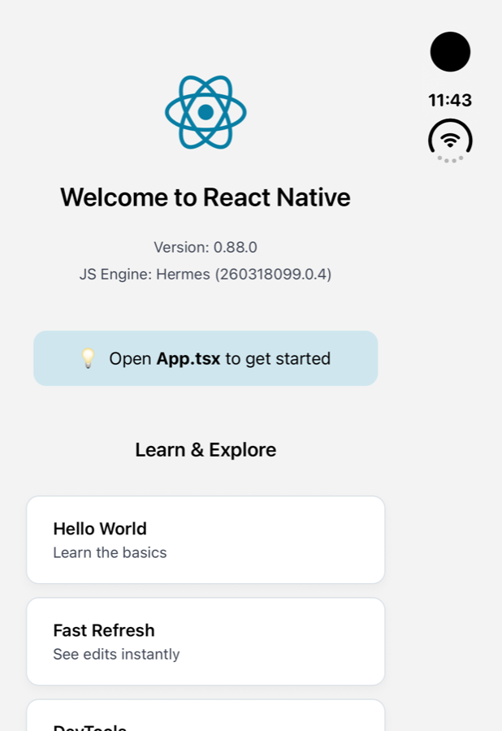

# Phase 3 results: general shaking

October 2026. General shaking (unused exports, and the modules only they needed, across the whole graph) on the two large apps from [real-apps-results.md](real-apps-results.md), the React Native template and the Expo apps from [Phase 0](phase0-results.md). How it works: [architecture.md](architecture.md#general-shaking-phase-3-shipped). How to reproduce: [benchmarks/real-apps](../benchmarks/real-apps) and [benchmarks](../benchmarks). Raw data: [benchmarks/reports/phase3](../benchmarks/reports/phase3).

## Headline

**On Rocket.Chat, Hermes bytecode drops 9.7% (1.59 MiB), against 0.2% for getter shaking alone. On Expensify, 3.6% (1.70 MiB).** Both with each app's own Babel config and the React Native CLI or Rock: Rocket.Chat keeps React Compiler on, Expensify keeps `@react-native/babel-preset`. Expo's tree shaking can't run on either setup.

Expo's shaker, on the Rocket.Chat build it could handle (Expo's Metro config, React Compiler off), saved 7.0%. The two baselines differ, so absolute sizes are the fairer comparison: **14.81 MiB with `metro-tree-shaker` (React Compiler on) against 14.96 MiB with Expo's shaker (React Compiler off).**

## Results

Hermes bytecode, iOS production builds.

| App, setup | Without shaking | With shaking | Change | Modules |
|---|---:|---:|---:|---:|
| Rocket.Chat, React Native CLI, React Compiler on | 16.40 MiB | 14.81 MiB | **−9.7%** (−1.59 MiB) | −608 |
| Rocket.Chat, Expo's Metro config, React Compiler off, Expo's shaker | 16.08 MiB | 14.96 MiB | −7.0% (−1.13 MiB) | −675 |
| Expensify, Rock with Metro (`BUNDLER=metro`) | 46.80 MiB | 45.10 MiB | **−3.6%** (−1.70 MiB) | −664 |

"With shaking" is `withTreeShaking` with its defaults: getter shaking and general shaking. Getter shaking alone saves 0.2% and 0.1% of these apps.

Where the bytes came from in Rocket.Chat (JavaScript, before Hermes):

| Package | Before | After | Change |
|---|---:|---:|---:|
| `@expo/vector-icons` | 451.9 KiB | 7.1 KiB | −98% |
| `@rocket.chat/ui-kit` | 228.0 KiB | 49.0 KiB | −79% |
| `rxjs` | 223.2 KiB | 152.7 KiB | −32% |
| `@expo/ui` | 67.4 KiB | 6.7 KiB | −90% |
| `react-native-gesture-handler` | 176.1 KiB | 128.1 KiB | −27% |
| `react-native` | 555.4 KiB | 520.9 KiB | −6% |
| `react-hook-form` | 53.8 KiB | 26.6 KiB | −51% |
| The app's own code | 4.48 MiB | 4.46 MiB | −0.3% |

`@expo/vector-icons` is the largest single difference from Expo's shaker, which kept all of it. Rocket.Chat imports only `createIconSetFromIcoMoon`, and the package declares `"sideEffects": false`, so its 50-odd icon sets and their glyph maps go. Its entry, `build/IconsLazy.js`, is published as Babel-compiled CommonJS, which Expo's shaker doesn't shake (it works on ESM syntax). `metro-tree-shaker` reads Babel's CommonJS output, which looks the same whether Babel ran in the app's build or in the library's publish step. The 8 files that stay are the entry (with every icon set gone from it), `createIconSetFromIcoMoon`, `createIconSet` and their helpers, and the app's `CustomIcon` loads the same way in both bundles.

In Expensify: `@sentry/conventions` −289 KiB (−99.8%), `entities` −160 KiB (−48%), `date-fns` −59 KiB, `react-native-gesture-handler` −54 KiB, `@sentry/core` −44 KiB, `@turf/helpers` −38 KiB. Its app code is 68% of the bundle and almost all of it is used.

## Build time

Release bundle with a cold cache (`--reset-cache`). Build times on this machine varied a lot between runs (other load), so these are ranges over three runs:

| App | General shaking's own time | Rounds |
|---|---:|---:|
| Rocket.Chat | 9–15 s | 8 |
| Expensify | 23–37 s | 9 |

On the quietest run, before the second minifier pass, that took Rocket.Chat's bundle from 16.7 to 28.0 s and Expensify's from 44.7 to 71.5 s. Most of the time is re-minifying the modules that changed, once per round. Development builds and the dev server are unaffected.

## Correctness

What was checked:

- **Fixtures.** 20 general-shaking cases, each built four ways (Metro's import support and Babel's CommonJS output, each with and without `inlineRequires`), and compared with plain Metro: same output when run, and the expected exports and modules gone. On every supported Metro minor, 0.82 to 0.87.
- **No dangling requires.** [`audit-requires.mjs`](../benchmarks/real-apps/audit-requires.mjs) reads only the final bundle and its source map. In both shaken apps, the only module that refers to a module the bundle doesn't define is `react-native/index.js`, whose unread getters do so by design.
- **Module initialization, plain vs. shaken.** [`compare-module-init.mjs`](../benchmarks/real-apps/compare-module-init.mjs) loads both bundles in Node with native modules stubbed, initializes every module the shaken bundle kept, in the same order in both, and compares which ones fail. Rocket.Chat: 4,587 modules compared. Expensify: 12,575. **No module fails only after shaking.** Some fail only in the plain bundle (29 in Rocket.Chat, 10 in Expensify), all with the same cause: `expo-asset` computes an export nobody reads at load time, which reads `expo-constants`, which fails parsing the stubbed manifest. Shaking removes that export, and `expo-constants` declares `"sideEffects": false`, so that load-time code is gone too. Modules that need a device fail in both bundles (438 and 3,607) and aren't compared beyond that point.
- **The benchmark apps.** Both checks also pass on the template and all four Expo apps (from 400 to 1,286 modules compared each): no dangling requires besides `react-native/index.js`, and no module that fails only after shaking. In the barrels app, the two `lucide-react-native` icons it renders (`camera`, `heart`) and lucide's shared icon code stay: 17 files out of about 1,900.
- **Sentry.** Expensify's shaken bundle and its source map carry the same debug ID.
- **The template** runs in the iOS Simulator as a Release build with both kinds of shaking (Xcode's bundling step logged 100 modules from getter shaking, then 121 exports and 5 modules from general shaking). It launched, rendered, scrolled and responded to taps, with no JavaScript errors in the log. It exercises little general shaking, so it's mainly a check that the two work together in a real build.

**Bugs found while measuring.** Two, both fixed, each with a fixture that fails without the fix:

1. A module like React's entry, `module.exports = require(prod)` or `require(dev)` picked at runtime, ships both branches when `NODE_ENV` isn't inlined (Expensify's case). Only the last branch counted as an alias, so the exports of the build that actually runs could be removed. Found by questioning a suspiciously large result. Every branch now counts ([`cjs-entry-picks-build`](../fixtures/cjs-entry-picks-build)).
2. Babel compiles an export that the module also uses itself to `var x = exports.x = value`. Removing the unread export replaced the whole assignment, so the module's own `x` became `undefined`. Found by the module-initialization check, in `react-native-math-view` in Rocket.Chat. The value now stays wherever it's used ([`export-used-locally`](../fixtures/export-used-locally)).

The shaker's own self-check couldn't catch either: it checks the result against the same analysis that made the mistake. That's why the independent checks above matter.

**Not checked:** neither app was run on a device (Rocket.Chat needs Expo prebuild and Firebase files that aren't in its repo; Expensify's native build is heavier still), and neither app's end-to-end tests ran. Code that runs after load, on render or on a tap, is only covered where the fixtures cover it. Treat the real-app results as "builds, and loads the same", not "works".

## Template and Expo apps

Hermes bytecode, iOS production builds (Android is within a few KiB).

| App | Without shaking | Getter shaking only | `metro-tree-shaker` | Expo's shaker |
|---|---:|---:|---:|---:|
| React Native template | 1227 KiB | 1091 KiB (−11.1%) | **1060 KiB (−13.6%)** | n/a |
| Expo's default template | 3539 KiB | 3435 KiB (−3.0%) | **2893 KiB (−18.3%)** | 3106 KiB (−12.2%) |
| Expo app importing from barrels (lucide, lodash-es, date-fns) | 4538 KiB | 4169 KiB (−8.1%) | **1368 KiB (−69.9%)** | 1751 KiB (−61.4%) |
| Template on Expo's Metro config, React Native's Babel preset | 2198 KiB | 2083 KiB (−5.3%) | **2044 KiB (−7.0%)** | 2198 KiB (+0.0%) |
| Template on Expo's Metro config and `babel-preset-expo` | 1266 KiB | 1142 KiB (−9.8%) | **1114 KiB (−12.1%)** | 1231 KiB (−2.8%) |

- **Barrel imports are where general shaking matters most.** The barrels app imports a few names each from `lucide-react-native`, `lodash-es` and `date-fns`; general shaking removes 70% of its bytecode (2,912 modules), more than Expo's shaker.
- **Expo's shaker needs `babel-preset-expo`.** On the template moved to Expo's Metro config with React Native's Babel preset, it removes nothing; with `babel-preset-expo`, little. `metro-tree-shaker` works the same on both.
- **On Expo's default template, `metro-tree-shaker` now removes more than Expo's shaker** (−18.3% against −12.2%), including in `react-native-reanimated` (347 KiB kept against Expo's 396 KiB). Until a late fix it was behind, keeping 614 KiB of reanimated. babel-preset-expo writes three things in shapes the analysis didn't recognize, and each made it keep everything a module exports:
  - its `export *` loop checks the module's own exports with `Object.prototype.hasOwnProperty.call(exports, key)` instead of `key in exports`. That pinned reanimated's entry, so every hook it re-exports stayed;
  - its `interopRequireDefault`, inlined by the minifier into `(e = t) && e.__esModule ? e : {default: e}` (134 importers across the app, 233 KiB of targets);
  - its `interopRequireWildcard`, which copies getters with `u.get ? u : {…}` (part of 151 importers).

  All three are recognized now, conservatively: if the helper's temporary is used anywhere else, the module still counts as read in full.
- On the template, general shaking adds 31 KiB on top of getter shaking: most of what's left is `react-native` itself, which uses the getter pattern rather than ESM exports.

## What's left

- **Precompiled CommonJS.** 911 of Rocket.Chat's modules and 1,918 of Expensify's replace `module.exports` wholesale, so their exports can't be removed. Their own imports are still tracked.
- **Side effects.** Unused modules are only dropped from packages that declare `sideEffects`. Most React Native libraries don't. The `sideEffects` option lets an app declare them; `side-effects-db` is still empty.
- **Runtime checks on real apps.** A device run of a large app, and its end-to-end tests, before calling this beta.
